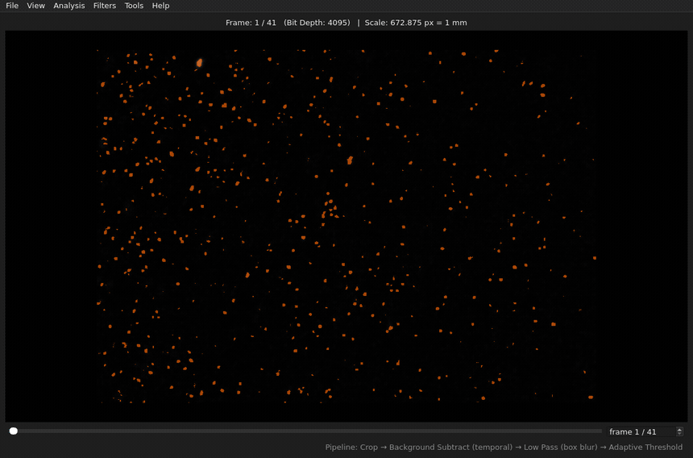
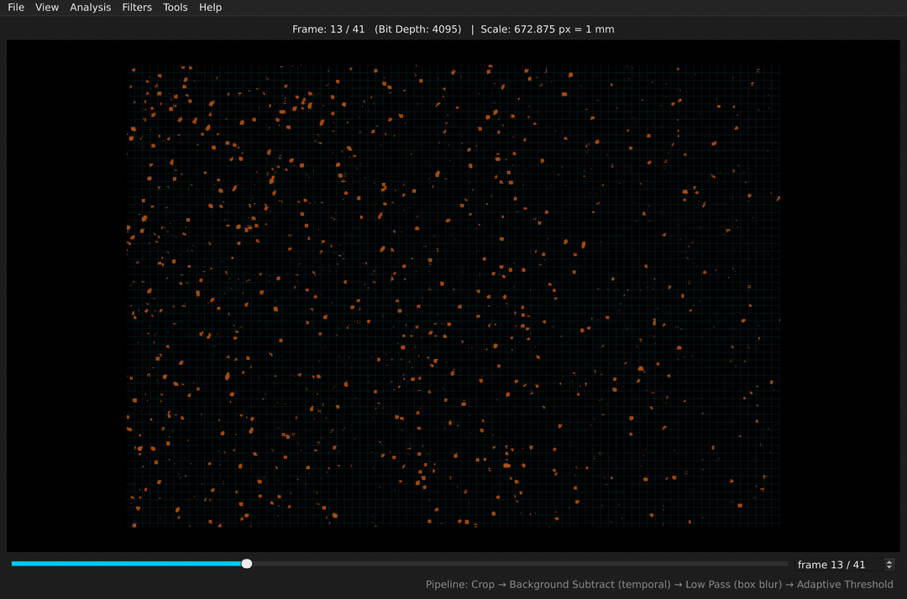
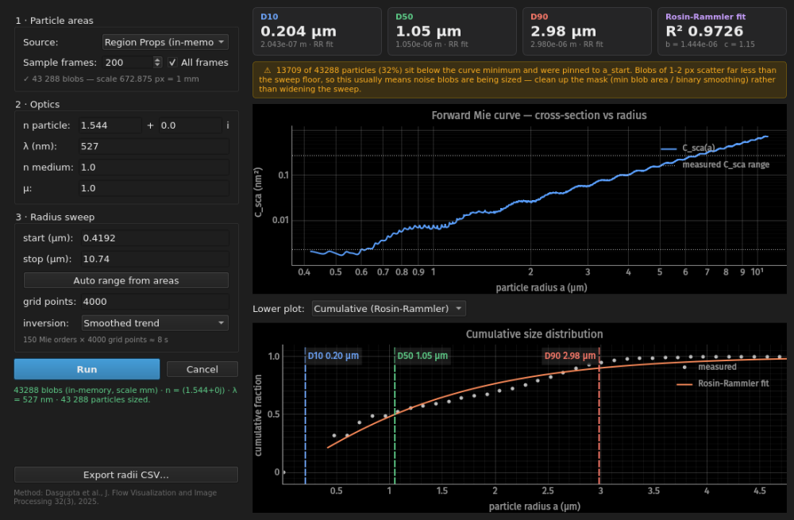

# tiffscope

**Fast scrubbing viewer and preprocessing pipeline for scientific TIFF image sequences.**

Built for looking at *thousands* of frames quickly: high-speed camera output, PIV/PTV particle images, SEM series, time-lapse microscopy, anything that lands on disk as a folder of grayscale TIFFs. Scrub at interactive speed, build a non-destructive processing pipeline, and export binary masks ready for downstream analysis.



*Scrubbing with the live threshold overlay on. The mask is recomputed per frame.*

## Why not ImageJ / Fiji?

tiffscope does one thing fast instead of everything slowly:

- **Instant scrubbing.** Sliding RAM buffer, lazy loading, precomputed display LUT. No full-stack load, no waiting.
- **Raw pixel fidelity.** 12/16-bit values shown unscaled in the pixel probe. Display contrast and gamma never touch the data.
- **Live, reorderable pipeline.** Every operation previews on the current frame as you tune it, at full scrub speed.

## Features

- **Lazy loading.** Folders with thousands of 12/16-bit frames open instantly. Only a ±20-frame window lives in RAM.
- **Non-destructive pipeline.** Add, reorder, enable/disable live:
  - Rotate, crop (interactive ROI), background subtraction (temporal or rolling-ball)
  - CLAHE, gaussian blur, sharpen, low/high pass
  - Thresholding with live overlay: adaptive or global (Otsu/manual), bright-on-dark or dark-on-bright
  - Binary mask chain: morphology, median smoothing, blob size filter, watershed splitting of merged particles
- **Pipelines save/load as JSON**, so preprocessing is reproducible and shareable.
- **Mask export.** The full binary chain as 0/255 uint8 TIFFs.
- **Analysis.** Blob size histogram, region props (area, diameter, axes, eccentricity) with physical units and CSV export, Mie particle sizing, live optical flow overlay.
- **Measurement.** Pixel-to-physical calibration, measurement rays, and perpendicular coating-thickness measurement on slanted facets.

## Installation

Requires **Python 3.10+**.

```bash
git clone https://github.com/tiffscope/tiffscope.git
cd tiffscope
python -m venv .venv
source .venv/bin/activate      # Windows: .venv\Scripts\activate
pip install -r requirements.txt
```

## Quickstart

```bash
python main.py
```

1. `Ctrl+O`, then pick any TIFF in your sequence folder. The whole folder loads in natural sort order.
2. Scrub with the slider, `←`/`→`, or type a frame number.
3. `Ctrl+P` opens the pipeline panel. Add stages, drag to reorder, tune with live preview.

   

   *Sweeping adaptive-threshold block size. The mask and the block grid track it live.*
4. `Ctrl+T` for contrast/gamma. After background subtraction, hit **Auto contrast**.
5. Add a threshold stage for a live binary overlay, then "Apply to All" and "Save Masks…".

`F1` lists every shortcut.

## Typical workflows

**PIV/PTV preprocessing.** Rotate, crop, background subtract, then export cleaned frames or particle masks.

**Particle sizing.** Threshold, morphology, blob size filter, intensity watershed to split touching particles, region props in physical units, CSV.

**Shadowgraphy / backlit.** Particles are dark on a bright field. Set the threshold op's *Polarity* to `dark_on_bright`. If you use the intensity watershed, also set its *Invert intensity*. The two switches are independent.

**Mie particle sizing.** Set a scale, threshold the laser-sheet-lit particles, then Analysis → *Mie Particle Sizing*. Each blob's area is treated as its scattering cross-section, a forward Mie curve is inverted per particle, and a Rosin-Rammler fit reports D10/D50/D90.



**Coating thickness.** Click the interface and outer surface on an SEM cross-section. Thickness is measured perpendicular to the fitted facet, with the fit residual as the error bar.

## Notes

- **Noise blobs skew small-particle statistics.** A noisy threshold leaves 1-2 px blobs that downstream analysis cannot distinguish from real particles. Use *Blob Size Analysis* to find the cutoff, then add a *Blob Size Filter* stage. Prefer it to morphological opening when area is the measurement, since opening erodes the blobs it keeps.
- **The Mie forward sweep is the expensive step.** Its cost is shown live before you run it, and it can be cancelled. Particles outside the swept radius range are clamped, and the window says so.

## Architecture

Six files, no packages: `image_engine.py` (I/O + pixel math), `operations.py` (processing ops), `pipeline.py` (ordering/caching/serialization), `measurement.py` (facet geometry), `mie.py` (Mie scattering + Rosin-Rammler), `main.py` (PyQt6 + pyqtgraph GUI). Everything except `main.py` has zero GUI imports and is usable headless.

The README media is generated by `docs/make_media.py`, which drives the app and assembles the GIFs with ffmpeg. Rerun it after a UI change instead of re-recording by hand.

## Roadmap

- Variable pre-cache size and smarter buffering
- Scale-image overlay for calibration embedding
- Faster peak detection in intensity watershed (pure-OpenCV NMS, dropping the scikit-image dependency)

Issues and PRs welcome.

## Citation

The Mie particle-sizing method is from:

> S. Dasgupta, S. Raut, V. Vadukut, M. Bose, "Design and Development of a Pneumatic Atomizer for Seeding Tracers in PIV Experiments," *Journal of Flow Visualization and Image Processing*, 32(3), 2025.

```bibtex
@article{dasgupta2025design,
  title={Design and Development of a Pneumatic Atomizer for Seeding Tracers in PIV Experiments},
  author={Dasgupta, Souvik and Raut, Swapnil and Vadukut, Vinoy and Bose, Manaswita},
  journal={Journal of Flow Visualization and Image Processing},
  volume={32},
  number={3},
  year={2025},
  publisher={Begel House Inc.}
}
```

## License

[MIT](LICENSE). [PyQt6](https://www.riverbankcomputing.com/software/pyqt/) (installed separately) is GPL-licensed. That affects redistribution of bundled binaries, not use of this source.
