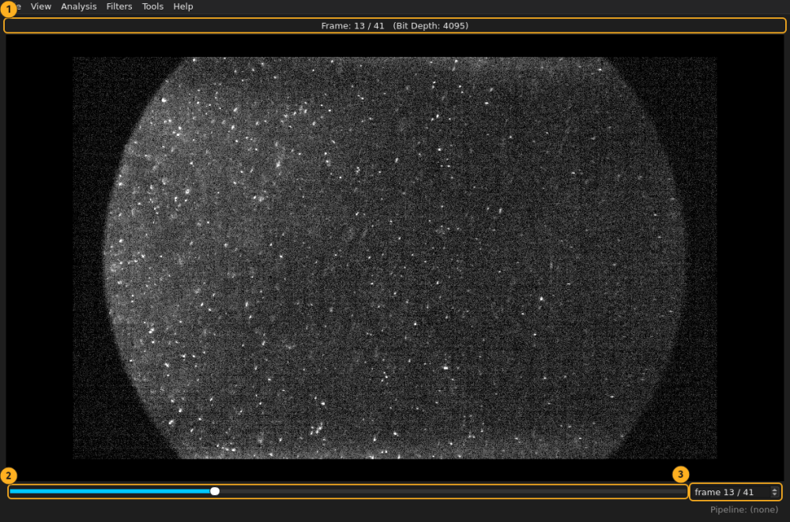
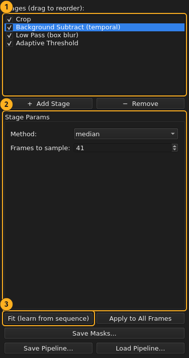
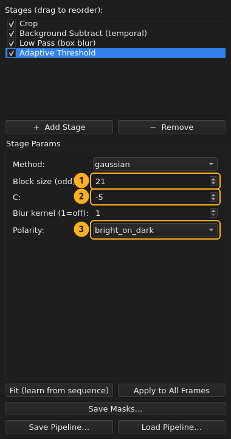
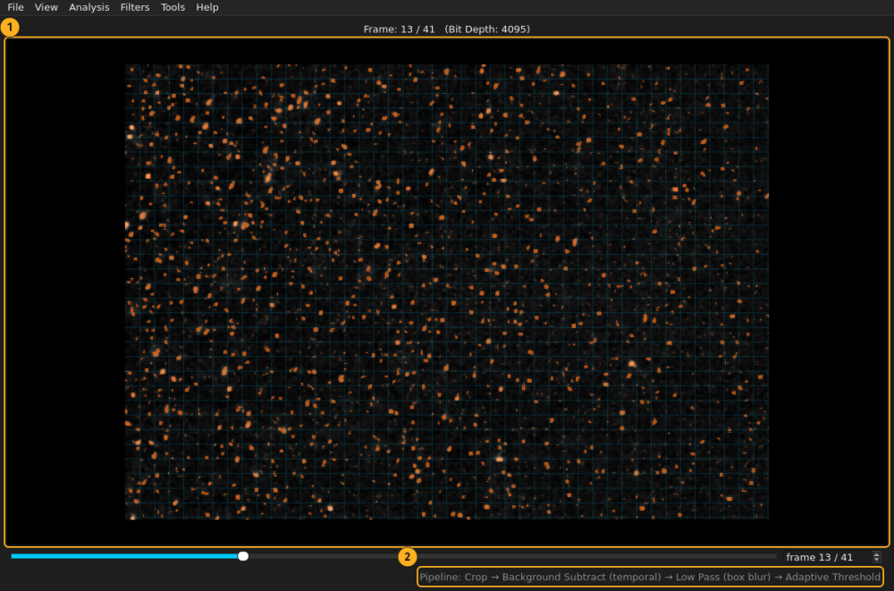
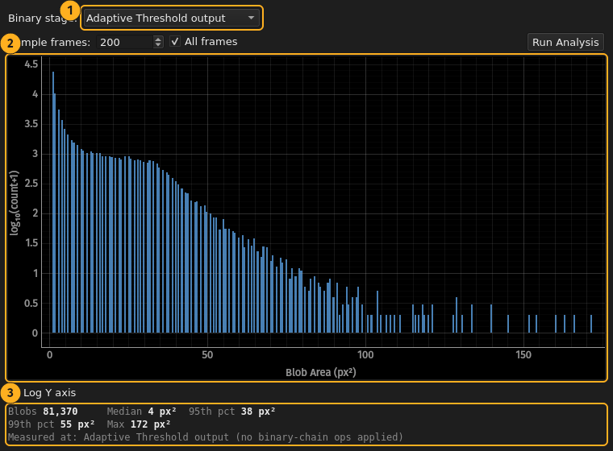
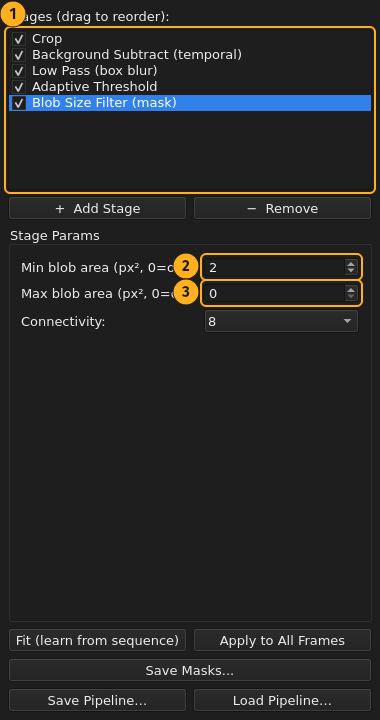
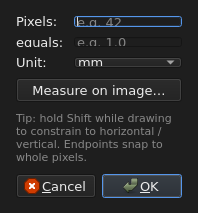
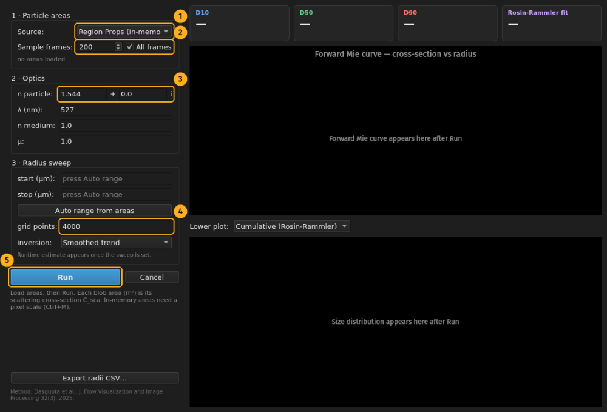
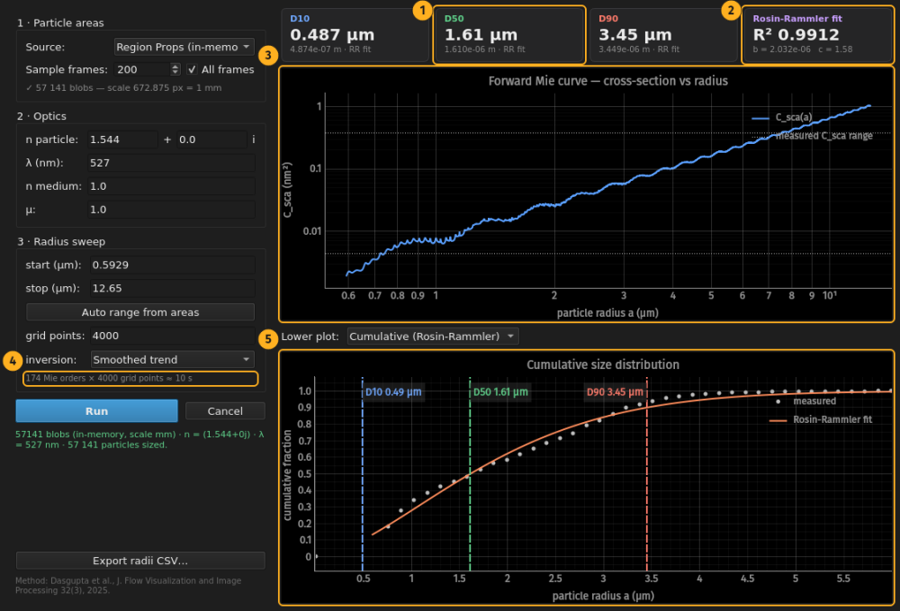
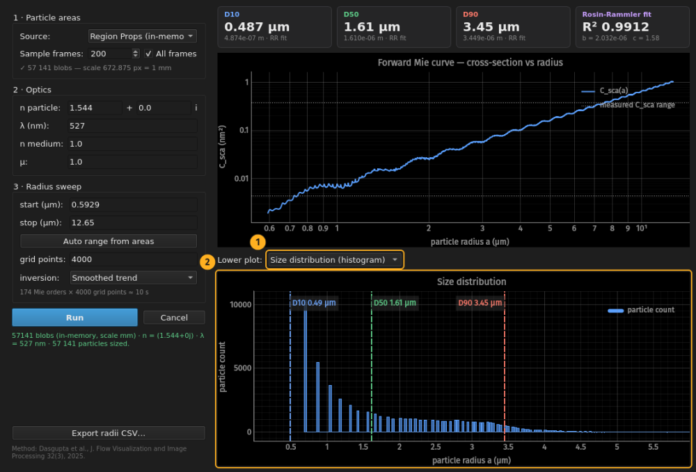

# Mie particle sizing: a full walkthrough

How to get a particle size distribution out of a laser-sheet image sequence,
start to finish. Every screenshot on this page comes from the same 41-frame
test sequence, so the numbers quoted here are the numbers you should see.

**The short version:** each blob in the binary mask is treated as one particle,
its area is its scattering cross-section C_sca, a forward Mie curve C_sca(a) is
inverted per particle to a radius, and the radii are fit with a Rosin-Rammler
model that reports D10/D50/D90.

**Before you start you need three things:**

1. A sequence where the particles are resolved blobs, not single pixels.
2. A pixel scale. Areas have to become square metres, and px² cannot.
3. The particle's refractive index at your laser wavelength. NaCl is 1.544,
   water is 1.33, glass is about 1.5.

---

## 1. Open the sequence

`Ctrl+O`, then pick any TIFF in the folder. The whole folder loads in natural
sort order.



1. Frame counter and bit depth. This sequence is 12-bit (max 4095).
2. Scrubber. Drag it, or use `←`/`→`, `PageUp`/`PageDown`, `Home`/`End`.
3. Frame number, 1-based. Type into it to jump.

Scrub the whole sequence once before doing anything else. You are looking for
frames where the illumination shifts, particles clump, or the field goes empty.
Those frames will show up later as outliers and it is better to know now.

If the image looks black, open `Ctrl+T` and press **Auto contrast**. Display
contrast never touches the pixel data, so this is always safe.

## 2. Crop and subtract the background

Open the pipeline panel with `Ctrl+P`. This sequence uses four stages: crop,
background subtract, low pass, threshold.



1. Stage list. Drag to reorder, uncheck to disable. Disabled is passthrough,
   not deleted.
2. Params for the selected stage. Everything previews live on the current frame.
3. **Fit**. Background subtraction learns a median image from the sequence, so
   it needs this once. The stage shows in orange until you do.

Two things worth knowing:

**Put the crop before the background subtract.** The background is computed at
whatever size it sees. On a 4096 px frame cropped to 512, fitting after the
crop is about 64 times faster.

**Use the temporal median when you have enough frames.** For very short
sequences the median still contains particle ghosts. In that case use *Rolling
Ball BG* instead, which estimates a spatial background per frame and needs no
fit.

## 3. Threshold, with the mask live on screen

Add a threshold stage from the Analysis menu. Adaptive suits uneven
illumination, global Otsu suits an evenly lit field.



1. **Block size.** The local window, in pixels. Must be odd. Bigger means a
   smoother local background, smaller means it tracks illumination faster.
   Rule of thumb: a few times your particle diameter.
2. **C.** Offset subtracted from the local mean. Negative pulls in more pixels,
   positive is stricter. This is the knob you actually tune.
3. **Polarity.** Leave at `bright_on_dark` for laser scattering. For
   shadowgraphy set `dark_on_bright`. The mask is always 255 = particle either
   way, so nothing downstream has to know.

The mask draws over the image in orange while you tune, and the block grid is
drawn too so you can compare the window size against real features.



1. Mask overlay and block grid, recomputed every frame.
2. The enabled stages, in order, along the bottom bar.

Scrub while the overlay is on. A setting that looks perfect on one frame and
loses half the particles on frame 30 is not a setting, it is a coincidence.

## 4. Find out what your mask actually contains

Analysis → **Blob Size Analysis**, tick *All frames*, tick *Log Y axis*, Run.



1. Which mask stage the sizes are measured on.
2. The distribution. Note the log axis.
3. Count, median, 95th, 99th, max.

This is the single most important step and it is the one people skip.

Read the plot: 81,370 blobs, **median 4 px²**. The leftmost bar is roughly
24,000 blobs of 1 px². A one pixel blob is not a resolved particle, it is
threshold noise, and nothing downstream can tell the difference. It will be
sized, and it will drag your small-particle statistics down.

## 5. Filter by size

Add a **Blob Size Filter** stage after the threshold.



1. The filter sits in the binary chain, after the threshold.
2. **Min area.** Set this from the histogram above. 0 turns it off.
3. **Max area.** Drops merged clumps that would otherwise be sized as one huge
   particle. 0 turns it off.

Use this rather than a morphological open. Opening erodes the blobs it keeps,
and for Mie sizing the blob area *is* the measurement, so eroding it corrupts
the answer. The size filter copies survivors pixel for pixel.

**Where to set min_area is a judgement call, and it moves the answer.** Measured
on this sequence, everything else held fixed:

| min_area (px²) | blobs | D10 (µm) | D50 (µm) | D90 (µm) | R² |
|---|---|---|---|---|---|
| 0 (off) | 81,370 | 0.169 | 1.012 | 3.170 | 0.985 |
| 2 | 57,141 | 0.487 | 1.610 | 3.449 | 0.991 |
| 3 | 46,793 | 0.769 | 1.953 | 3.538 | 0.995 |
| 4 | 41,320 | 1.002 | 2.168 | 3.544 | 0.998 |
| 6 | 35,040 | 1.312 | 2.420 | 3.576 | 0.999 |
| 9 | 29,696 | 1.633 | 2.637 | 3.578 | 0.999 |

Three things to take from that table:

- **D90 is robust.** It moves 13% across the whole range. D10 moves 10x.
- **There is no plateau.** min_area does not converge on a true answer, so
  quote it alongside any D-value you report.
- **Rising R² is not evidence of correctness.** Trimming the tail off a
  distribution always makes a two-parameter fit look better.

The rest of this page uses `min_area = 2`, which is the floor: one pixel cannot
be a resolved particle.

## 6. Set the pixel scale

`Ctrl+M`. Enter a known pixel count and what it equals.



This sequence is calibrated at **672.875 px = 1 mm**. **Measure on image** lets
you drag across a calibration target instead of typing, and endpoints snap to
whole pixels.

Without a scale the Mie window will not run on in-memory areas at all. That is
deliberate. There is no sensible guess to fall back on.

## 7. Set up the Mie run

Analysis → **Mie Particle Sizing**. The controls read top to bottom as three
numbered steps.



1. **Source.** *Region Props* measures blobs from the open sequence. *CSV*
   reads an `Area` column from a file, for areas that are already physical.
2. **Sampling.** Tick *All frames* for a final number. A smaller sample is for
   checking your settings quickly.
3. **Refractive index** of the particle. 1.544 for NaCl. The imaginary part is
   absorption, 0 for a transparent particle.
4. **Grid points.** Resolution of the forward sweep. 50000 matches the original
   MATLAB. 4000 is plenty for tuning and much faster.
5. **Run.**

Also set λ to your laser wavelength (527 nm here) and leave *n medium* at 1.0
for air and *μ* at 1.0.

You do not have to fill in the radius sweep. Run collects the areas first and
seeds the sweep from them, using a geometric estimate a ≈ √(A/π) with a little
headroom. **Auto range from areas** re-seeds it later if you change the mask.

Keep the sweep tight. Runtime scales with the largest radius in it, so a loose
upper bound costs minutes and leaves most of the x-axis empty.

## 8. Read the result



1. **D50**, the median radius. 1.61 µm here. The small print under each card
   gives the value in metres and says whether it came from the Rosin-Rammler
   fit or from empirical percentiles.
2. **Fit quality.** R² 0.9912, with the fitted b and c. If the fit fails to
   converge the window says so and falls back to percentiles, which are
   distribution-free and stay usable on small samples.
3. **The forward Mie curve.** Log-log C_sca against radius. The dotted lines
   mark the range your measured cross-sections actually occupy. If they sit
   against either end of the curve, your sweep does not cover your data.
4. **Cost estimate**, shown before you commit: 174 Mie orders x 4000 grid
   points, about 10 s. Cancel works during the sweep.
5. **The Rosin-Rammler fit.** Dots are measured, the line is the fit, and the
   dashed markers are D10/D50/D90.

If particles get clamped to either end of the sweep, a warning appears above
the plots and the fix depends on which end:

- **Clamped high** means the sweep is too narrow. Raise the stop.
- **Clamped low** usually does *not* mean that. In the Rayleigh limit C_sca
  goes as a⁶, so tiny noise blobs fall below the curve floor no matter how you
  bracket the sweep. The fix is `min_area`, not a wider sweep.

## 9. Look at the distribution, not just the CDF

Switch the lower plot to **Size distribution**.



1. Lower plot selector.
2. The radius histogram, with the same D-value markers.

Always look at this before quoting a D50. A cumulative curve hides the mode and
it hides bimodality completely. Two populations that a CDF renders as one gentle
S-curve are obvious here.

**Export radii CSV** writes the per-particle radii along with a header
recording every input, so a run can be reproduced.

---

## What to report

Quote all of these together, because each one moves the answer:

- `min_area` and which mask stage the areas came from
- Refractive index and wavelength
- Radius sweep bracket and grid points
- Inversion method (*Smoothed trend* by default, *Legacy* only to reproduce
  older MATLAB runs)
- Number of particles sized
- Whether D-values came from the Rosin-Rammler fit or from percentiles

## Regenerating these images

Every screenshot here is produced by driving the real app, not by a screen
recorder:

```bash
python docs/make_walkthrough.py <sequence-folder> <pipeline.json> docs/
```

Callout badges are placed from live widget geometry, so moving or resizing a
control keeps its badge. Rerun this after a UI change instead of editing the
images.

## Method

> S. Dasgupta, S. Raut, V. Vadukut, M. Bose, "Design and Development of a
> Pneumatic Atomizer for Seeding Tracers in PIV Experiments," *Journal of Flow
> Visualization and Image Processing*, 32(3), 2025.
